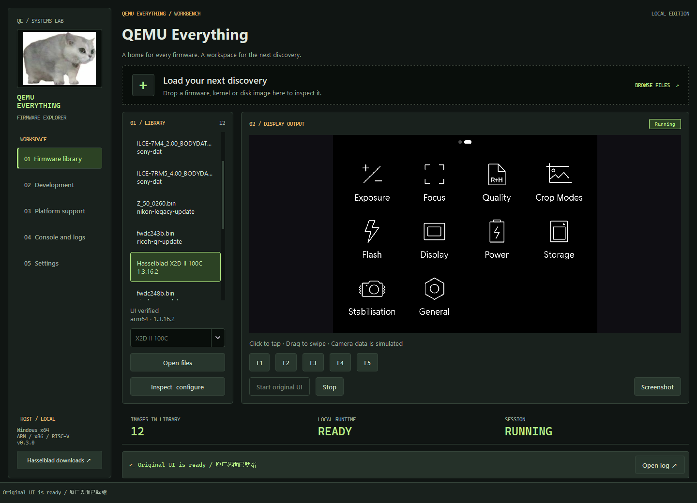

# QEMU Everything

**Inspect firmware, build a local support workspace, and run compatible kernels, disk images or original Hasselblad interfaces in QEMU.**

Formerly **Hasselblad X System QEMU DevKit**. The existing camera UI adapters remain available. QEMU Everything adds a general firmware library and reviewed boot profiles; its name describes the project's direction, not a claim that every firmware already boots.

[简体中文](README.zh-CN.md) · [Releases](https://github.com/derrickyau9/QEMU-Everything/releases)

This is the new QEMU Everything repository. Use the source launcher below until a portable build is published here.



## Start with your firmware

1. Run `Launch.cmd` from source. Portable builds use **QEMU-Everything.exe** in **QEMU-Everything-Windows-x64.zip**; older published releases may still have the previous name.
2. Download firmware from its manufacturer and drop the local file into the workbench. Import records its SHA-256 and detectable format/architecture, then creates a library entry.
3. A recognized Hasselblad `.cim` uses the existing **original UI** adapter. Compatible generic kernels and disk images use a **boot profile**. Unknown or encrypted updates remain available for inspection and support development.
4. Review the selected boot profile, prepare the required runtime, and start. Generic guests use QEMU's own display window and the workbench console. Camera UI sessions retain embedded touch input and screenshots.

[General firmware guide](docs/GENERAL_FIRMWARE.md) · [Multi-brand camera research](docs/CAMERA_FIRMWARE.md) · [Architecture](docs/ARCHITECTURE.md)

For a supported Hasselblad UI, first use prompts for the Android SDK license before downloading the guest runtime. Click to tap, drag to swipe, and use **Stop** to close the owned QEMU process. Later launches use cached firmware and runtime offline.

The camera UI runtime download is approximately **615 MB**. Allow **8 GB free disk space**, a Windows x64 computer, and preferably at least 8 GB RAM. Generic guests can prepare QEMU independently and do not require the Android SDK. Runtime files are extracted into your user profile; no administrator privileges or system-wide installation is needed.

## What you get

- Import files into a local library with SHA-256 identities and inspection reports.
- Create support workspaces for new firmware instead of silently treating unknown packages as compatible.
- Review JSON boot profiles for ARM64 `virt`, ARM `virt`, x86-64 `pc`, or RISC-V 64 `virt`; run compatible direct kernels or disk images with temporary disk writes and networking disabled.
- Use the CLI to inspect, import, list boards, run and export support information.
- Extract checked Sony, Nikon, Ricoh, Canon and Insta360 components offline; see the model/version matrix below.
- Start verified Nikon Z7 C3.80, Z30 C1.20, Z6 C3.80 and Z50 C2.60 assisted menu labs with separately built custom QEMU.
- Run the original Insta360 X3 emWin GUI with native touch and a verified 72MP → 18MP → 72MP menu roundtrip.
- Import Ricoh GR IV 1.11 and open its original Focus Settings menu, including native Confirm and Back, with a separately built UI platform.
- Import the official GoPro HERO8 2.51 update and run its original Tara camera and VIDEO menus with a separately built UI platform.
- Extract Sigma fp 5.02 MAIN through the reviewed offline DFI reader; original UI bringup remains in development.
- Run bounded original Linux/rootfs checks for Sony A7 IV / A7R V, Ricoh GR and Insta360 X3 from the workbench or CLI.
- Original firmware UI, streamed directly from a minimal Wayland compositor in QEMU.
- Start/stop controls, correctly scaled mouse touch input and PNG screenshots.
- English / Simplified Chinese; a default **CRT Retro** theme in ink black, phosphor green and amber. System / light / dark themes remain available, with Iris / Blue / Leaf accents for those classic themes.
- A guest console, persistent logs and an editable **hello.c** development workspace.
- **Build app → Run app** using an installed Android NDK; no NDK is needed to run the original UI.
- Import, select and remove validated third-party Wayland app packages for the local QEMU guest.
- Build a [NetSurf browser prototype](docs/BROWSER_PROTOTYPE.md) for X1D or X2D II guest app sessions, with touch input and optional X2D II QEMU networking.
- Disposable system writes and a separate data disk per imported firmware.

## Compatibility and support status

| Item | Status |
| --- | --- |
| Windows x64 host | Supported; portable Qt application |
| macOS Apple Silicon | Supported from source after the macOS setup in [docs/MACOS.md](docs/MACOS.md); no portable package yet |
| X2D II 1.2.7.16 | Original UI, menu navigation and Display submenu verified |
| X2D II 1.3.16.2 | See [verification record](docs/VERIFICATION.md) |
| Additional profiles | X1D, X1D II, X2D and 907X 50C; see the preview matrix below |
| Generic kernels / disk images | Boot profiles are available; each image must match the selected QEMU board |
| Unknown / proprietary updates | Inspect and create a support workspace; no automatic boot claim |
| Nikon Z7 C3.80 / Z30 C1.20 | Original menus, submenu entry and return verified using assisted startup; custom QEMU/WSL labs |
| Nikon Z6 C3.80 | Original Playback menu and DOWN/UP selection round trip verified using assisted startup; LCD scanout, natural boot and imaging unverified |
| Nikon Z50 C2.60 | Original MY MENU → Add items → MY MENU verified in one QEMU instance; assisted startup, natural boot and imaging unverified |
| Sony A7 IV 2.00 | Original Linux/rootfs shell boot; [original diagnostic widgets, icon, font and pointer response verified](docs/sony-a7iv-diagnostic-ui-verification-20261011.json) in a separate component experiment; normal camera menus and complete boot unverified |
| Sony A7R V 4.00 | Original Linux 4.9.337-scel and ext2 rootfs shell boot; [original diagnostic widgets, icon, font and pointer response verified](docs/sony-a7rv-diagnostic-ui-verification-20261011.json) in a separate component experiment; normal camera menus and complete boot unverified |
| Ricoh GR III 2.10 / IIIx 1.60 | Original Linux/rootfs shells boot; camctld runs in restrict mode; RTOS IPC and camera UI remain unverified |
| Ricoh GR IV 1.11 | [Original TopMenu → Focus settings → Back verified](scripts/boards/ricoh/evidence/griv-1.11-menu-roundtrip.json), with native Up/Down and exact frame restoration; assisted component available through the workbench; full camera cold boot and imaging unverified |
| Insta360 X3 v1.1.4.1_build1 | Original emWin resolution menu and native touch roundtrip verified with a separate GUI platform adapter; Linux root shell also boots; full ThreadX/RTOS–Linux boot and imaging unverified |
| Canon EOS 50D 1.0.9 | Original DryOS updater boots; full ROMs/ROM1 seed are needed for main-firmware/UI bring-up |
| Canon EOS 70D 1.1.2 | Original ROM reset boot displays the 720 × 480 Canon menu; native Down/Up selection roundtrip verified. Requires the exact complete ROM and serial-flash set; an official update alone is insufficient |
| GoPro HERO8 Black 2.51 | Original Tara camera → VIDEO presets → Back roundtrip verified in one QEMU instance; assisted UI component startup, original cold boot and recording unverified |
| Camera UI rendering | QEMU TCG + Qt Quick software backend |
| Camera guest hardware acceleration | Not implemented for this ARM64 guest on x86-64 Windows |
| Capture, ISP, AF, lens, USB camera, real storage | Not emulated |
| Physical camera installation / firmware flashing | Not provided |

The Hasselblad adapter runs the **original camera user interface in a development guest**, with Android ARM32, Android ARM64 or Linux ARMhf libraries selected for the firmware and simulated camera services. It does not boot the camera's original kernel or reproduce the complete camera hardware. UI responsiveness varies with the host CPU. Camera values are mocked and some actions are intentionally unsupported. Nikon labs call original firmware functions and change guest RAM during assisted startup; natural power-on and full imaging hardware remain unverified.

Additional Linux labs use independently built QEMU boards, development device trees and explicit bootloader setup. After importing and extracting a matching firmware, configure its local build as described in [camera firmware research](docs/CAMERA_FIRMWARE.md). **Start camera Linux lab** runs a 30-second check; **Cancel** stops its owned guest. This provides serial boot evidence, with camera UI status recorded separately.

The **Original UI lab** entry also selects the exact Nikon, X3, Canon 70D, Ricoh GR IV or GoPro HERO8 profile when its
separate build is configured. See [Z50 setup](scripts/boards/nikon-z50/README.md)
and [X3 setup](scripts/boards/insta360/UI_README.md). X3 executes original widgets,
fonts and handlers with eight explicit platform hooks in guest RAM (68 bytes);
it bypasses the ThreadX scheduler. Verified original menus do not establish
complete camera boot, live view or recording.

The [Canon EOS 70D 1.1.2 lab](scripts/boards/canon/README.md) boots the original
ROM from reset and displays the original menu. Native Down/Up selection and
workbench startup/cleanup are verified. It requires three exact ROM/serial-flash
files supplied separately; an official update is insufficient. Subpages, tab
navigation and imaging remain unverified.

The Sony A7 IV and A7R V diagnostic components are separate research experiments. They run
original widgets, resources and fonts with software peripheral support;
diagnostic text is supplied by the developer. These experiments are not integrated into the
**Original UI lab** button. Normal camera menus and complete boot remain unverified.

The [Ricoh GR IV component lab](scripts/boards/ricoh/README.md) is available through
the workbench's **Original UI lab** button after the separate build is configured.
Import the exact official 1.11 `fwdc248b.bin`; the importer extracts and validates
its original payload. System QEMU executes original TopMenu, Focus settings,
fonts and icons with read-only resources and a software display. Native Up/Down,
Confirm and Back are verified. The adapter calls the original transition-completion
API; full RTOS animation timing, camera cold boot, physical LCD, capture and
Linux/RTOS IPC remain unverified.

A firmware signature or CPU architecture is only an inspection result. Booting the original system also requires an appropriate board, boot chain and drivers. Generic `virt`/`pc` profiles do not reproduce proprietary camera SoCs. Unrecognized firmware receives a draft support workspace so those requirements can be investigated and recorded. Verified camera UI compatibility remains in [the verification matrix](docs/VERIFICATION.md).

In the Hasselblad adapter, a local development copy adapts embedded QML image visibility or the legacy root window for software rendering. The original executable is retained, executable instructions are not patched, and no modified firmware is written back to the `.cim` file. See [architecture](docs/ARCHITECTURE.md).

## Develop an app

The next camera research target is **native X2D II 4K60p recording**. This is
offline feasibility work, not an implemented capture feature. See the
[firmware evidence and development plan](docs/X2DII_VIDEO_RESEARCH.md).

1. Import and select firmware.
2. Open **Development → Open development workspace**.
3. Edit `hello.c` in your editor.
4. Select your [Android NDK](https://developer.android.com/ndk/downloads) folder (**r27 tested**).
5. Stop any running guest, click **Build app**, then **Run app**.

The example is a `wl_shm` client compiled for the selected firmware ABI. It runs in its own guest session; stop it and start Original UI to return. The firmware payload is read-only while QEMU runs, so stop before rebuilding. Custom Qt guest applications require a Qt toolchain matching the selected guest ABI, which is not included. A Windows Qt executable cannot run inside this guest.

[Development guide](docs/DEVELOPMENT.md) · [Troubleshooting](docs/TROUBLESHOOTING.md)

Third-party `.xdevapp` packages can be created from guest ELF programs with
[`scripts/app_packages.py`](scripts/app_packages.py), then imported on the
Development page. The package must match the selected model and ABI. It runs
in a separate local QEMU session and does not install on a physical camera.

## Run from source

Install Python **3.11+**, clone the repository, and double-click `Launch.cmd`. It creates a local virtual environment and installs dependencies on the first run.

```powershell
git clone https://github.com/derrickyau9/QEMU-Everything.git
cd QEMU-Everything
.\Launch.cmd
```

For contributors:

```powershell
python -m venv .venv
.\.venv\Scripts\python -m pip install -e ".[dev]"
.\.venv\Scripts\python -m pytest -q
.\.venv\Scripts\python run_app.py
.\.venv\Scripts\python scripts/build.py
```

New data lives in `%LOCALAPPDATA%\QEMU-Everything`. An existing `%LOCALAPPDATA%\X2DII-DevKit` library is reused automatically. Set `QEMU_EVERYTHING_HOME` or pass `--home <directory>` for a different location; the older `X2DII_DEVKIT_HOME` variable and launch aliases remain supported. Avoid commas in runtime/data paths. Firmware files, extracted assets, runtime downloads, logs and user workspaces are excluded from Git.

On macOS Apple Silicon, use the source launcher after completing the [macOS setup](docs/MACOS.md):

```sh
./Launch.sh --home "$HOME/Library/Application Support/QEMU-Everything"
```

CLI examples after installing from source:

```powershell
qemu-everything inspect C:\Firmware\update.dat
qemu-everything boards
qemu-everything import C:\Firmware\Image
qemu-everything support <device-directory>
qemu-everything run <device-directory>
```

Inspection never executes the supplied firmware. A generic run requires a valid boot profile and installed QEMU. See the [profile workflow](docs/GENERAL_FIRMWARE.md) before starting a new image.

## Additional camera profiles (v0.2.0)

| Camera | Firmware inputs | UI checks |
| --- | --- | --- |
| X1D 50C | 1.20.0, 1.21.0, 1.25.0 | Linux ARMhf; see the verification matrix |
| X1D II 50C | 1.0.1, 1.0.2, 1.1.0, 1.2.0, 1.3.0, 1.4.0, 1.5.2 | Android ARM32; main menu and settings navigation |
| X2D 100C | 1.0.5, 4.2.0 | Android ARM64; original UI and settings navigation |
| 907X / CFV II 50C | 1.5.2 | Shared package with X1D II; choose the camera in the library |

These additions are available in v0.2.0 as UI development previews. **907X / CFV 100C is not covered.** The X1D II and CFV II 1.5.2 input files supplied for testing are byte-identical, so importing both creates one library entry with two camera choices.

X1D downloads about 78 MB of pinned Debian ARMhf libraries on first launch, then works offline. Allow about 12 GB free for initial X1D setup, plus space for additional firmware. It runs the original Linux UI with a Qt 5.15 compatibility runtime inside the guest; the camera kernel and hardware are not emulated. X1D displays at 640×480. F1–F5 buttons send the UI's virtual camera keys. The launcher opens the main menu for development.

The app compiler now selects Android ARM32, Android ARM64 or Linux ARMhf from the selected firmware. NDK r27 clang is used for all three; Linux builds also use the downloaded sysroot. Windows/macOS binaries cannot run as guest apps. Original UI and custom apps run in separate sessions.

See [verification details](docs/VERIFICATION.md). Menu controls backed by unimplemented hardware services can remain unavailable; displayed camera data is synthetic.

## Credits and licensing

- **[Radium Wang / radium-wang — Hasselblad X-System CIM Firmware Research & Feature Extensions](https://github.com/radium-wang/Hasselblad-X-System-CIM-Firmware-Research-Feature-Extensions)** — reference and background for offline CIM firmware analysis and original UI/menu extension research. Thank you for making this research available.
- **[Derrick Yao / tsla-infotainment-lab](https://github.com/derrickyau9/tsla-infotainment-lab)** — Material theme and native Qt workbench design; adapted with its MIT notice preserved. Reference commit: `f590d8fd9a053ab072df94b994c0a58ee7b976ed`.
- Existing local X2D II QEMU/UI research and CIM container tools by Derrick Yao form the basis of the guest adapters and import pipeline.
- [QEMU](https://www.qemu.org/), [Stefan Weil's Windows builds](https://qemu.weilnetz.de/), Android/AOSP, Qt for Python, 7-Zip, Dissect, pyfdt, pyelftools, Brotli and cryptography.

QEMU Everything is **AGPL-3.0-or-later**, including the requirements of its Dissect filesystem dependency. The adapted theme retains its MIT notice. The portable package includes project source and third-party license notices; Qt libraries remain separately replaceable in the distribution. See [THIRD_PARTY_NOTICES.md](THIRD_PARTY_NOTICES.md).

Manufacturer firmware, fonts, artwork, libraries and trademarks belong to their respective owners. They are **not distributed in this repository or release**. Users supply their own official firmware. This project is not affiliated with or endorsed by Hasselblad or other firmware manufacturers.

## Disclaimer

Provided **as is**, without warranty. You use it at your own risk. You are solely responsible for consequences including any loss of warranty, camera damage, data loss or other loss arising from your use or modifications. This DevKit operates locally and does not provide camera flashing or installation functions.
